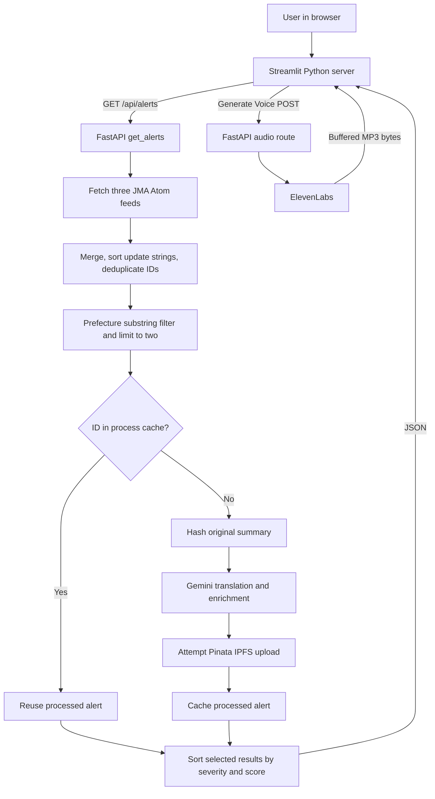

# Read the code from input to output

Source links use repository-relative paths. Function names are the stable navigation points. The committed reference is `99f36da`; local retry additions are called out separately.

## Architecture



Solana is outside this main path. The manual `fetch_jma_alerts_verified()` helper calls it separately.

The Streamlit server makes the HTTP requests. The user's browser interacts with Streamlit; this is not a JavaScript frontend directly calling FastAPI.

## Every tracked file

| File | Responsibility and interview relevance |
| --- | --- |
| [app/main.py](../app/main.py) | Application setup, CORS, static directory, three endpoints, filtering, cache, ordering |
| [app/models.py](../app/models.py) | Pydantic request/data models and inheritance |
| [app/scraper.py](../app/scraper.py) | Feed ingestion, per-fetch deduplication, optional full provenance pipeline |
| [app/translator.py](../app/translator.py) | Gemini prompt, JSON cleanup, fallbacks, ElevenLabs calls |
| [app/utils/hasher.py](../app/utils/hasher.py) | SHA-256 of UTF-8 text |
| [app/utils/ipfs.py](../app/utils/ipfs.py) | Pinata HTTP upload and response validation |
| [app/utils/solana.py](../app/utils/solana.py) | Signed Solana memo transaction submission |
| [app/utils/__init__.py](../app/utils/__init__.py) | Empty package initializer |
| [frontend/app.py](../frontend/app.py) | Streamlit interaction, state, rendering, API requests, demo alert |
| [requirements.txt](../requirements.txt) | Direct dependency version pins |
| [.python-version](../.python-version) | Python 3.12.9 runtime pin |
| [render.yaml](../render.yaml) | Blueprint defining the backend service only |
| [.env_sample](../.env_sample) | Environment-variable names with blank credential values and a sample Gemini model |
| [.gitignore](../.gitignore) | Excludes local secrets, environments, caches, and editor folders |
| [.devcontainer/devcontainer.json](../.devcontainer/devcontainer.json) | Development container, installation and two application launch commands |
| [.vscode/settings.json](../.vscode/settings.json) | Tracked editor/chat settings; no application behavior |
| [README.md](../README.md) | Product, usage, deployment, and demo narrative; some claims exceed current code |
| [PORTFOLIO.md](../PORTFOLIO.md) | Project summary; correctly notes the optional Solana path |
| [INSTRUCTIONS.md](../INSTRUCTIONS.md) | Original staged roadmap; some names/routes differ from the final implementation |

There is no tracked database schema, custom blockchain program, Dockerfile for production, background worker, test suite, or CI workflow. The local `tests/` directory contained only a cache directory, not test source files.

## 1. Data contracts: app/models.py

`Alert` requires five strings: `id`, `title`, `summary`, `link`, and `updated`. Optional fields are `hash`, `ipfs_cid`, `prefecture`, and `category`.

`TranslatedAlert` inherits all of those fields and adds English/Chinese titles, summaries, emergency-action strings, and an optional floating-point trust score.

`AudioRequest` requires `text` and defaults `language` to `"en"`.

`Provenance` defines a source URL, fetch timestamp, original hash, and CID, but is not instantiated in the active flow.

Notice the limits of these models: `updated` is a string rather than a validated datetime; `category` and `language` are strings rather than enums; no text-length limits are declared. The score is clamped in translator logic rather than constrained in the model.

## 2. Ingestion: fetch_jma_alerts()

In [scraper.py](../app/scraper.py), three URLs are parsed sequentially with `feedparser.parse(url)`. Entries from all feeds are accumulated and sorted descending by their `updated` strings.

The loop skips missing IDs and IDs already in `seen_ids`. It chooses the description from the first `content` value, otherwise `summary`, otherwise a fixed “No details available.” string. It constructs an `Alert` and adds its ID to the set.

A per-entry exception handler tries a minimally populated fallback and otherwise skips the entry. This is not comprehensive feed-transport error handling: the code does not explicitly inspect HTTP/feed error status or configure a timeout for the URL fetch.

Two subtleties:

- This reads Atom entry content. It does not follow each entry's link to parse the full JMA bulletin XML.
- Sorting timestamp strings works only under compatible representations. Equivalent instants with different offsets should be normalized to datetimes before comparison.

The module's manual `__main__` block calls this raw-fetch function, then tries to print translated fields that `Alert` does not have. That diagnostic path can fail; it is not proof of automated testing.

## 3. Main route: get_alerts()

In [main.py](../app/main.py), `GET /api/alerts` defaults to `prefecture=Tokyo`.

1. Fetch all raw alerts.
2. Map the English prefecture label to a Japanese substring.
3. For “All Prefectures,” choose the first two raw results.
4. Otherwise select matching title/summary strings and take the first two.
5. If there are no matches, also choose the first two raw results.
6. For each selected ID, return its cached processed object if present.
7. On a cache miss, hash `a.summary`, call `translate_alert_data(a)`, and attempt an IPFS upload.
8. Add the processed object to `_alert_cache`, even when translation fell back or IPFS failed.
9. Sort the selected results by category priority, then trust score, both descending.
10. Serialize with `jsonable_encoder`.

Priority values are Critical = 100, Warning = 50, Advisory = 10, and unknown = 0. A missing/falsy score sorts as zero. This is severity ordering of the selected subset; it is not a global search for the most severe alerts.

There are 47 prefectures in the UI but only 37 Japanese mappings in the backend. Missing mappings are Okayama, Hiroshima, Yamaguchi, Tokushima, Kagawa, Ehime, Kochi, Fukuoka, Saga, and Nagasaki. Unmapped English names are searched literally in Japanese text, which commonly yields no match and triggers fallback.

### A concrete trace

Assume the newest distinct entries are A (Osaka), B (Tokyo), and C (Tokyo), followed by D (Tokyo).

- Selecting Tokyo filters to B, C, D, then slices to B and C.
- D is excluded before Gemini can classify it, even if D would be Critical.
- If B is already cached, only C undergoes hashing, translation, and attempted pinning.
- Selecting an unmatched prefecture returns A and B through fallback.
- Selecting All Prefectures also chooses A and B.
- A new request always fetches the feeds; the cache does not cache feed downloads.

## 4. Translation: translate_alert_data()

In [translator.py](../app/translator.py), credentials and model name come from environment variables. The code constructs a `google.genai.Client` and requests JSON output with temperature 0.1.

The prompt asks for both translations, emergency actions, a primary prefecture, category, and a 0–10 trust score. The prompt contains competing instructions: preserve or extract official actions, but also supply generic procedures when specifics are missing. That can produce advice beyond the source.

The response path removes Markdown fences if present, uses a greedy brace regex to extract an object, parses it with `json.loads`, converts/clamps the trust score, normalizes action lists, and joins those actions into strings using `" | "`.

`_model_to_dict` supports Pydantic v2's `model_dump()` and the older `dict()` method. The code removes existing prefecture/category keys before passing the enriched versions into `TranslatedAlert`, avoiding duplicate keyword arguments.

Any exception in the translation attempt returns a fallback object. Its English/Chinese fields contain original Japanese text, prefecture becomes Unknown, category becomes Advisory, trust score is null, and emergency actions become a generic failure message. This preserves a response but may visually understate a serious alert.

JSON output mode helps formatting. The code does not supply a response schema to Gemini, and parseable JSON does not establish correct meaning.

## 5. Provenance helpers

[hasher.py](../app/utils/hasher.py) checks for a string, encodes it as UTF-8, and returns a SHA-256 hexadecimal digest. In the main route only the Japanese summary is hashed. Titles, timestamps, translations, and action text are outside that digest.

[ipfs.py](../app/utils/ipfs.py) validates that input is a mapping, loads Pinata credentials, and POSTs `{"pinataContent": dict(data)}` to Pinata with a 60-second timeout. It checks HTTP success and a nonempty string `IpfsHash`. The caller catches upload failure so an alert can still be returned.

The JSON is uploaded before `t_alert.ipfs_cid` is set. Therefore the stored snapshot normally has a null CID field; the returned API object receives the CID afterward.

[solana.py](../app/utils/solana.py) constructs `SOS_PROOF:<hash>|<cid>`, obtains a recent blockhash, builds a Memo Program instruction, compiles a versioned message, signs using the configured keypair, and submits the transaction. The network is chosen by `SOLANA_RPC_URL`; the project documents devnet, but the helper does not enforce it.

Submission returns a signature or, for caught failures, `SOLANA_FAILED`. Missing configuration raises before that try block. There is no confirmation polling or persistence of a transaction signature in the alert model.

The manual `fetch_jma_alerts_verified()` pipeline hashes, translates, pins, sleeps between steps, and calls the Solana helper. It ignores the returned transaction status. The ordinary `GET /api/alerts` imports the helper but never calls it.

## 6. Endpoint reference

| Endpoint | Input | Output | Actual behavior |
| --- | --- | --- | --- |
| `GET /api/alerts` | Query string `prefecture`, default Tokyo | JSON array, normally 0–2 processed alerts | Fetches, filters, caches, enriches, sorts |
| `POST /api/translate` | An `Alert` JSON body | One translated/fallback alert | Calls Gemini path directly; no hashing/pinning/cache in this route |
| `POST /api/generate-audio/{alert_id:path}` | Path ID plus `AudioRequest` JSON | MP3 bytes, `audio/mpeg` | Synthesizes submitted text; does not look up or verify the ID |

Illustrative request bodies:

```json
{
  "id": "practice-alert-1",
  "title": "Japanese title supplied here",
  "summary": "Japanese summary supplied here",
  "link": "https://www.jma.go.jp/",
  "updated": "2026-05-10T09:00:00+09:00"
}
```

```json
{
  "text": "Illustrative text for speech.",
  "language": "en"
}
```

These examples describe the contract; they are not real alerts or recorded test results. Calling translation, audio, or the main alerts route with valid credentials can use external-service quota.

## 7. Audio generation

The frontend combines the selected language's title, summary, and actions into `tts_text`. It posts that text and `en` or `zh` to the backend.

`generate_audio()` uses ElevenLabs `eleven_multilingual_v2`, chooses one voice for Chinese and another otherwise, and requests `mp3_44100_128`. It joins the returned byte chunks with `b"".join(audio)`. The HTTP response is buffered audio, not a streaming response.

The frontend stores audio under `audio_<alert ID>_<language>` and renders a player. This avoids regenerating just to replay existing audio in that session, but clicking Generate Voice again still sends another request.

The `alert_id:path` converter accepts slash-containing IDs. Inside the route, the ID is unused.

## 8. Frontend state and local retry changes

[frontend/app.py](../frontend/app.py) resolves the backend URL in this order: Streamlit secrets, environment variable, localhost. It displays a prefecture selector defaulting to Tokyo, a language selector, Refresh Alerts, demo mode, and alert cards.

Alerts are fetched only on explicit refresh or when session state has no alerts. Changing the prefecture alone does not fetch new data once the list is nonempty. Changing language can reuse the existing bilingual fields.

The audio checkbox sets `auto_generate`, but nothing reads it afterward. The expander subheading always uses the English title even when Chinese is selected. The UI does not show the retained original JMA link as a source button.

Demo mode prepends a synthetic alert with a fixed ID and placeholder hash/CID. It does not pass through the scraper or provenance pipeline. Repeated demo clicks can duplicate IDs and therefore Streamlit button keys.

The pre-existing local change adds five-attempt retry handling with fixed six-second pauses and a retry status message. It catches all `HTTPError` values, including errors beyond the explicitly listed 502/503/504 statuses. It is not exponential backoff. Invalid JSON or a non-list response is not retried by that catch block. The baseline committed frontend has a single request with a 60-second timeout.

## 9. Deployment and configuration

`uvicorn app.main:app` means “import the app object from the app.main module.” The backend blueprint binds to `0.0.0.0` and the platform-provided port. The frontend is a separate service according to the README; it is not defined in `render.yaml`.

| Setting | Consumer | Why it exists |
| --- | --- | --- |
| `GEMINI_API_KEY`, `GEMINI_MODEL` | Translation helper | Credential and model selection |
| `ELEVENLABS_API_KEY` | Audio helper | Speech provider credential |
| `PINATA_API_KEY`, `PINATA_SECRET_KEY` | IPFS helper | Pinning credentials |
| `SOLANA_RPC_URL`, `SOLANA_PRIVATE_KEY` | Manual Solana helper | Network endpoint and signer |
| `API_BASE_URL` | Frontend | Reach the backend in local or hosted environments |

These are configuration names, not seven interchangeable API keys. No secret values are needed in interview answers.

Requirements pin direct packages, including FastAPI 0.136.1, Streamlit 1.57.0, google-genai 2.0.0, Pydantic 2.13.4, and ElevenLabs 2.46.0. Those are repository versions, not recommendations to install the latest release.

The devcontainer uses Python 3.11 while `.python-version` specifies 3.12.9. That is an environment-parity gap. The container also disables Streamlit CORS/XSRF protections in its development launch command; do not present that command as a hardened production configuration.
